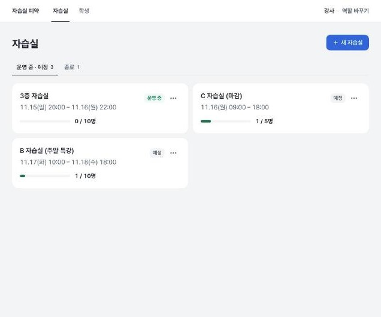

# hiconsy-task

하이컨시 과제전형 레포입니다. Vue 3(FE)와 NestJS(BE)로 구성된 풀스택 모노레포입니다.

## 과제 주제: 자습실 방문 예약 시스템

단톡방으로 받던 자습실 예약을 시스템으로 옮기는 MVP입니다.

- **강사**: 자습실(최대 인원, 운영 기간)을 등록·수정·삭제하고, 학생들의 신청·수정·취소 이력을 조회합니다.
- **학생**: 운영 기간 안에서 방문 시간을 정해 신청하고, 본인 신청을 수정·취소합니다.
- 로그인 대신 화면에서 강사/학생을 선택합니다.

요구사항(FR), 기능 정의(FN), 필수 엔티티 원문 정리: [docs/requirements.md](./docs/requirements.md)

### 화면

| 강사 · 자습실 목록                                   | 강사 · 자습실 상세 (이력)                                        |
| ---------------------------------------------------- | ---------------------------------------------------------------- |
|  |  |
| **학생 · 방문 신청**                                 | **학생 · 내 신청 (취소됨)**                                      |
|    |                 |

- 정원(`7 / 10명`, 학생은 `남은 자리`)과 내 신청 여부를 목록 카드에서 바로 보여줍니다.
- 방문 시간은 운영 기간 안·현재 이후의 30분 단위 선택지만 고를 수 있습니다.
- 시스템이 취소한 신청(자습실 삭제)은 학생의 취소됨 탭에 사유와 함께 남습니다.
- 내 다른 신청과 겹치는 시간은 선택지에서 비활성화되고, 정원이 방금 차서 거절되면 같은 시간에 자리가 남은 자습실로 이어서 신청할 수 있습니다.
- 마지막 1자리에 두 학생이 동시에 신청하는 장면: [화면에서 본 동시 신청](./docs/solutions/study-room-capacity-concurrency.md#3-3-화면에서-본-동시-신청-35)
- 디자인 원칙과 실제 토큰·대비 측정 결과: [apps/web/DESIGN.md](./apps/web/DESIGN.md)

### 구현 범위

명세의 필수·선택 요구사항을 모두 구현했습니다.

| 구분 | ID        | 요구사항                             | 구현                                                                   |
| ---- | --------- | ------------------------------------ | ---------------------------------------------------------------------- |
| 필수 | FR-ROM-01 | 자습실 목록 (삭제 제외)              | ✅ 운영 기간·정원·현재 신청 인원                                       |
| 필수 | FR-ROM-02 | 자습실 등록 (최대 인원, 운영 기간)   | ✅ 시작 < 종료 검사                                                    |
| 필수 | FR-ROM-03 | 자습실 상세의 신청·수정·취소 이력    | ✅ 시간순 타임라인 + 현재 신청자(연락처) 탭                            |
| 필수 | FR-ROM-04 | 최대 인원·운영 기간 수정             | ✅                                                                     |
| 필수 | FR-ROM-05 | 자습실 삭제 (Soft Delete)            | ✅                                                                     |
| 필수 | FR-STD-01 | 학생 목록                            | ✅                                                                     |
| 필수 | FR-VST-01 | 방문 신청 (운영 기간·정원·중복 검사) | ✅ 정원은 트랜잭션 + 자습실 행 락으로 보장                             |
| 필수 | FR-VST-02 | 방문 시간 수정                       | ✅                                                                     |
| 필수 | FR-VST-03 | 방문 취소                            | ✅ 정원 복원, 취소 후 재신청 가능                                      |
| 선택 | FR-VST-04 | 내 방문 신청 목록                    | ✅ 예정 / 지난 방문 / 취소됨(사유 포함)                                |
| 선택 | FR-ROM-06 | 자습실 수정·삭제 시 기존 신청 처리   | ✅ 정원 축소·기간 변경은 막고(#7·#8), 삭제는 자동 취소(#9)             |
| 선택 | FR-STD-02 | 학생 등록·수정·삭제                  | ✅ Soft Delete, 삭제 시 신청 자동 취소, 전화번호 정규화·중복 방지(#10) |

명세 밖에서 추가한 것:

- **같은 학생의 시간 겹침 방지**(#13): 다른 자습실이라도 같은 시간에 두 곳을 신청할 수 없습니다.
- **정원 마감 시 다른 자습실 안내**: 거절되면 같은 시간에 자리가 남은 자습실을 보여주고, 그 시간으로 이어서 신청합니다.
- **동시성 검증**: 정원·시간 겹침을 동시 요청 e2e로 고정하고, 락을 빼면 테스트가 실패하는 것을 확인했습니다. → [docs/solutions](./docs/solutions/)
- **웹 E2E**(Playwright, 데스크톱 1280 + 모바일 320)와 접근성 점검(키보드 조작, 대비 측정)

### 직접 정한 규칙

명세만으로 정해지지 않는 부분은 아래처럼 정했습니다. 상세와 근거: [docs/requirements.md 9절](./docs/requirements.md#9-해석이-필요한-부분)

| #   | 항목               | 규칙                                                                                             | 이유                                                                                                |
| --- | ------------------ | ------------------------------------------------------------------------------------------------ | --------------------------------------------------------------------------------------------------- |
| 1   | 방문 시간          | 시작~종료 **구간**으로 신청, 구간 전체가 운영 기간 안                                            | "7시에 가기로 했는데 8시로" — 시간대가 의미 있는 정보                                               |
| 2   | 정원 기준          | **자습실 단위**. 유효 신청(취소 제외) 수 ≤ 최대 인원                                             | 명세의 "자습실별 신청 인원". 시간대별 정원은 확장 여지로 남김                                       |
| 3   | 재신청             | 취소 후 같은 자습실에 **다시 신청 가능**. 중복 금지는 "유효 신청 1건" 기준                       | 마음을 바꾼 학생을 막을 이유가 없음                                                                 |
| 4   | 이력 저장          | 신청(현재 상태)과 이력(이벤트)을 **테이블 분리**                                                 | 정원·중복 검사와 이력 조회를 각각 단순하게                                                          |
| 5   | 정원 동시성        | 트랜잭션 + **자습실 행 `FOR UPDATE`** 로 검사와 저장을 원자적으로                                | 마지막 자리에 동시에 신청해도 정원을 넘지 않게                                                      |
| 6   | 과거 시간          | 방문 시작이 **현재 이후**여야 신청·수정 가능 (400 `VISIT_IN_PAST`)                               | 지나간 사실을 바꾸지 못하게                                                                         |
| 7   | 최대 인원 축소     | 현재 신청 인원보다 작게 줄이면 **막음** (409 `CAPACITY_BELOW_CURRENT`)                           | 학생 모르게 신청이 취소되지 않게, 강사가 먼저 조율                                                  |
| 8   | 운영 기간 변경     | 유효 신청이 새 기간 밖으로 밀려나면 **막음** (409 `PERIOD_EXCLUDES_VISITS`)                      | 7번과 같음                                                                                          |
| 9   | 자습실 삭제        | 허용하고 유효 신청 **자동 취소**, 이력에 `SYSTEM`·"자습실 삭제"                                  | 강사의 명시적 의도. 학생은 취소 사유를 확인 가능                                                    |
| 10  | 학생 삭제·전화번호 | 삭제 시 신청 자동 취소. 전화번호는 휴대폰만, `010-1234-5678`로 정규화, 활성 학생끼리 중복 불가   | 전화번호가 실질적 식별자. 삭제된 학생 번호는 재사용 가능                                            |
| 11  | 신청 주체          | 로그인 대신 **경로의 학생 id**를 본인으로. 다른 학생 신청은 404                                  | 명세가 로그인 생략 허용. 404로 존재 여부도 숨김                                                     |
| 12  | 수정·취소 시점     | **이미 시작된 방문**은 수정·취소 불가 (409 `VISIT_ALREADY_STARTED`)                              | 이력과 실제가 어긋나지 않게                                                                         |
| 13  | 시간 겹침          | 같은 학생의 유효 신청끼리 **구간이 겹치면 안 됨** (409 `VISIT_TIME_OVERLAP`), 맞닿는 구간은 허용 | 한 사람이 두 곳에 있을 수 없고, 겹친 신청은 다른 학생의 자리를 차지                                 |
| 14  | ~~대기열~~         | **제거함 (#44)**. 10분짜리 자리 제안 방식으로 구현했다가(#36) 좌석 단위 예약으로 전환하며 뺌     | 좌석·시간을 직접 고르면 다른 좌석·시간으로 신청하면 됨 → [기록](./docs/solutions/waitlist-offer.md) |

동시 요청에서 누가 먼저 등록되는지는 **서버에서 락을 먼저 잡은 순서(선착순)** 입니다. 동시성 제어는 "정원을 넘지 않고 남은 자리만큼만 성공"을 보장하고, 공정성(추첨·대기열 등)은 정책의 영역으로 분리했습니다. → [정원 마감 직전의 동시 신청 처리](./docs/solutions/study-room-capacity-concurrency.md#5-공정성-누가-이기는가)

## 목차

1. [프로젝트 실행 방법](#1-프로젝트-실행-방법)
2. [기술 스택 및 선택 이유](#2-기술-스택-및-선택-이유)
3. [아키텍처 및 컨벤션](#3-아키텍처-및-컨벤션)
4. [데이터베이스 스키마](#4-데이터베이스-스키마)
5. [개발 시 고민한 점 / 아쉬운 점](#5-개발-시-고민한-점--아쉬운-점)

---

## 1. 프로젝트 실행 방법

### 방법 A. Docker로 전체 실행 (권장)

Docker만 설치되어 있으면 Node.js/pnpm 설치 없이 실행할 수 있습니다.

```bash
docker compose up --build
```

| 주소                           | 설명               |
| ------------------------------ | ------------------ |
| http://localhost:8080          | 프론트엔드 (nginx) |
| http://localhost:3000/api      | 백엔드 API         |
| http://localhost:3000/api/docs | Swagger API 문서   |

컨테이너 시작 시 DB 마이그레이션과 시드 데이터가 자동으로 적용됩니다.
종료: `docker compose down` (DB 데이터까지 삭제: `docker compose down -v`)

### 방법 B. 로컬 개발 모드

요구 사항: Node.js 24+, pnpm 12 (`npm i -g pnpm@12` 또는 `corepack enable`), Docker

```bash
pnpm install                          # 의존성 설치 + Prisma Client 생성
cp apps/api/.env.example apps/api/.env
pnpm db:up                            # PostgreSQL 실행 (localhost:5434)
pnpm db:migrate                       # 마이그레이션 적용
pnpm db:seed                          # 시드 데이터
pnpm dev                              # web + api 동시 실행 (hot reload)
```

| 주소                           | 설명             |
| ------------------------------ | ---------------- |
| http://localhost:5173          | 프론트엔드       |
| http://localhost:3000/api      | 백엔드 API       |
| http://localhost:3000/api/docs | Swagger API 문서 |

### 테스트

```bash
pnpm test        # 단위 테스트 (web, api)
pnpm test:e2e    # API e2e + 웹 E2E — pnpm db:up 필요
pnpm lint        # lint
pnpm typecheck   # 타입 체크
```

**웹 E2E (Playwright)** — 실제 브라우저에서 강사·학생 흐름을 버튼을 눌러 가며 확인합니다.

```bash
pnpm --filter @hiconsy/web exec playwright install chromium   # 처음 한 번 (약 100MB)
pnpm test:e2e:ui                            # 루트에서 UI 모드로 열기 — 단계별로 보며 실행
pnpm --filter @hiconsy/web test:e2e         # 웹 E2E만 실행 (데스크톱 1280 + 모바일 320)
```

- API(3100)·웹(5174) 서버를 테스트가 직접 띄우므로, 개발 서버(3000/5173)를 켜 둔 채로 돌려도 겹치지 않습니다.
- 개발 DB와 분리된 `hiconsy_web_e2e` DB를 쓰고(없으면 자동 생성), 테스트마다 데이터를 비웁니다.
- 실패하면 `apps/web/playwright-report`에 스크린샷과 trace가 남습니다 (`pnpm --filter @hiconsy/web exec playwright show-report`).
- 시나리오: 역할 선택·권한 이동, 강사 자습실 등록·수정 거절·이력·삭제, 학생 관리, 학생 신청·시간 변경·취소·다시 신청, 정원 마감·동시 신청, 키보드 조작, 320px 가로 스크롤

모든 PR에서 GitHub Actions로 lint, 타입 체크, 테스트, 빌드, API e2e(PostgreSQL), 웹 E2E(Playwright), Docker 빌드를 검증합니다.

### 환경변수

| 파일            | 읽는 곳                                | 필요 여부                       |
| --------------- | -------------------------------------- | ------------------------------- |
| `.env` (루트)   | `docker-compose.yml`                   | 선택. 없으면 기본값 사용        |
| `apps/api/.env` | NestJS, Prisma CLI (마이그레이션·시드) | 로컬 개발 모드에서 필수         |
| `apps/web/.env` | Vite                                   | 선택. 비우면 `/api` 프록시 사용 |

루트 `.env`로 바꿀 수 있는 값 (`cp .env.example .env`):

| 환경변수            | 기본값    | 대상                   |
| ------------------- | --------- | ---------------------- |
| `POSTGRES_USER`     | `hiconsy` | DB 사용자              |
| `POSTGRES_PASSWORD` | `hiconsy` | DB 비밀번호            |
| `POSTGRES_DB`       | `hiconsy` | DB 이름                |
| `POSTGRES_PORT`     | `5434`    | PostgreSQL 호스트 포트 |
| `API_PORT`          | `3000`    | Docker api 포트        |
| `WEB_PORT`          | `8080`    | Docker web 포트        |

Docker 전체 실행(방법 A)에서는 api 컨테이너의 `DATABASE_URL`이 위 값으로 자동 조합됩니다.
로컬 개발 모드(방법 B)에서 DB 값이나 포트를 바꿨다면 `apps/api/.env`의 `DATABASE_URL`도 같이 맞춰야 합니다.

### DB 접속 (pgAdmin, DBeaver 등)

| 항목     | 값 (기본값)                            |
| -------- | -------------------------------------- |
| Host     | `localhost`                            |
| Port     | `5434` (`POSTGRES_PORT`)               |
| Database | `hiconsy` (e2e 테스트: `hiconsy_test`) |
| Username | `hiconsy`                              |
| Password | `hiconsy`                              |

- pgAdmin을 Docker로 실행했다면 Host에 `host.docker.internal`을 입력합니다.
- GUI 없이 보려면 `pnpm --filter @hiconsy/api prisma:studio`를 실행합니다.

---

## 2. 기술 스택 및 선택 이유

| 영역      | 기술                                                                                          |
| --------- | --------------------------------------------------------------------------------------------- |
| Frontend  | Vue 3 (Composition API), Vite, TypeScript, Vue Router, Pinia, Axios, Tailwind CSS v4, Reka UI |
| Backend   | NestJS 12, Prisma 7, PostgreSQL 16, Swagger, class-validator                                  |
| 공통      | pnpm workspace, Turborepo, TypeScript, Vitest                                                 |
| 품질 관리 | ESLint, oxlint, Prettier, husky, commitlint, lint-staged, GitHub Actions                      |
| 인프라    | Docker, Docker Compose, nginx                                                                 |

자세한 선택 이유: [docs/tech-stack.md](./docs/tech-stack.md)

---

## 3. 아키텍처 및 컨벤션

```
apps/
  web/              # Vue 3 SPA (+ docs/ UI/UX 설계 문서)
  api/              # NestJS REST API (+ prisma/ 스키마·마이그레이션)
packages/
  shared/           # FE/BE 공유 타입 (API 요청/응답 계약)
  tsconfig/         # 공통 tsconfig
infra/postgres/     # DB 초기화 스크립트
docs/               # 상세 문서
```

- 아키텍처 (인프라, 소스 코드 구조, 요청 흐름): [docs/architecture.md](./docs/architecture.md)
- 컨벤션 (브랜치 전략, 커밋, 코드 스타일): [CONTRIBUTING.md](./CONTRIBUTING.md)
- 문제 해결 기록 (문제·선택지·검증): [docs/solutions](./docs/solutions/)
  - [정원 마감 직전의 동시 신청 처리](./docs/solutions/study-room-capacity-concurrency.md) — 자습실 행 락, 대안 비교, 공정성
  - [방문 시간 겹침과 동시 요청 처리](./docs/solutions/visit-time-overlap-concurrency.md) — 학생 행 락 모드, 교착 상태
  - [대기열: 대기 등록과 자리 제안](./docs/solutions/waitlist-offer.md) — 자동 확정 대신 제안, 지연 동기화, 롤백 함정, 학생 삭제 교착 상태 해소
- 확정 전 설계 초안 (방향은 정했지만 구현 전): [docs/tbd](./docs/tbd/)
  - [좌석 단위 예약 전환](./docs/tbd/seat-based-reservation.md) — 자습실 단위 정원 → 학생이 좌석을 고르는 예약, 미정 결정 사항
- UI/UX 설계 (사용자 흐름, 화면 명세, 디자인 시스템, UI 구현 방식): [apps/web/docs](./apps/web/docs/README.md)

---

## 4. 데이터베이스 스키마

| 테이블            | 역할                                         |
| ----------------- | -------------------------------------------- |
| `students`        | 학생 (Soft Delete)                           |
| `study_rooms`     | 자습실: 최대 인원, 운영 기간 (Soft Delete)   |
| `visits`          | 방문 신청의 현재 상태 (학생-자습실 쌍당 1행) |
| `visit_histories` | 신청·수정·취소 이벤트 로그 (append-only)     |

- 신청(현재 상태)과 이력(이벤트)을 분리해 정원·중복 검사와 이력 조회를 각각 단순하게 유지
- `UNIQUE(student_id, study_room_id)` + 상태 전환으로 중복 신청 방지와 취소 후 재신청을 함께 지원
- 정원은 트랜잭션 안에서 자습실 행을 `FOR UPDATE`로 잠근 뒤 검사

ERD와 자세한 설계 이유: [docs/database.md](./docs/database.md)

---

## 5. 개발 시 고민한 점 / 아쉬운 점

[docs/retrospective.md](./docs/retrospective.md)
