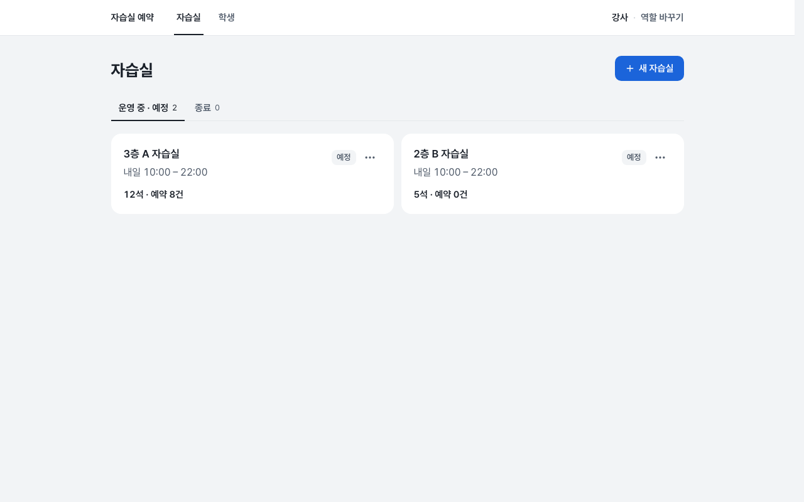
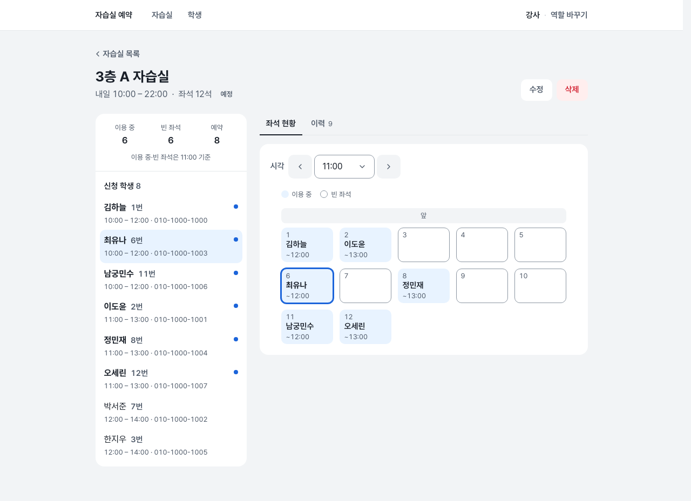
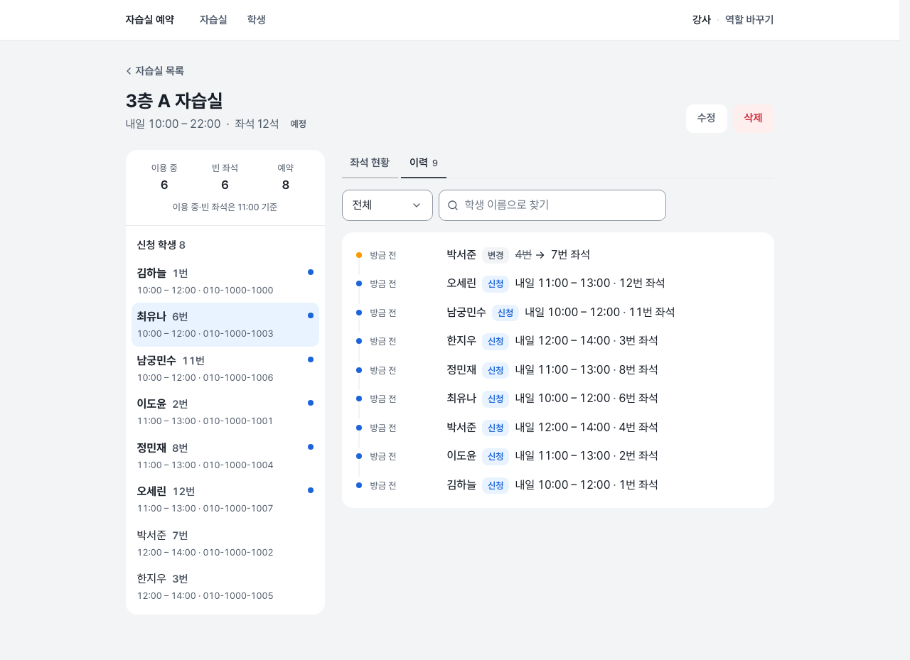
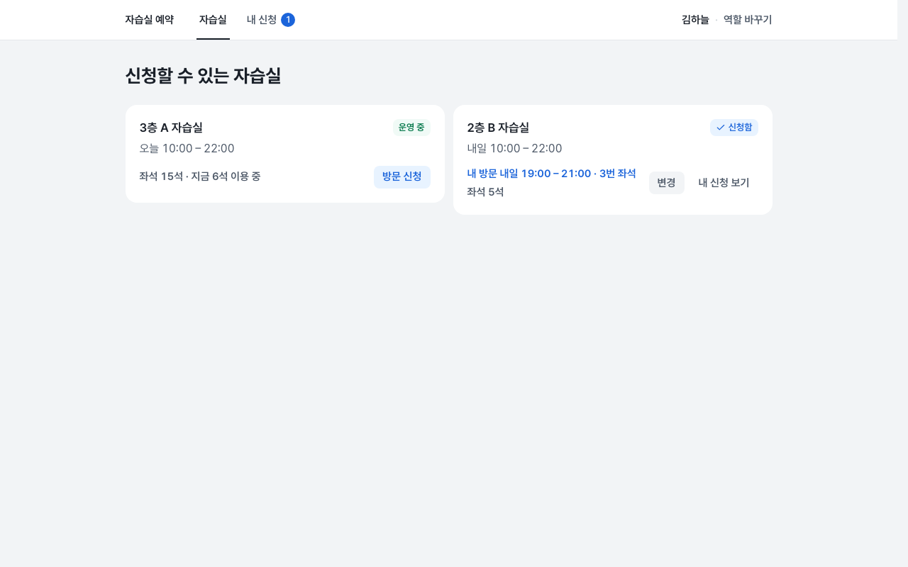
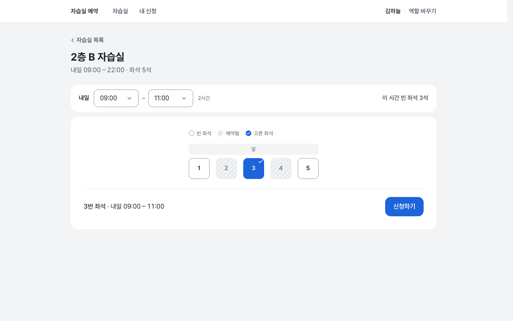
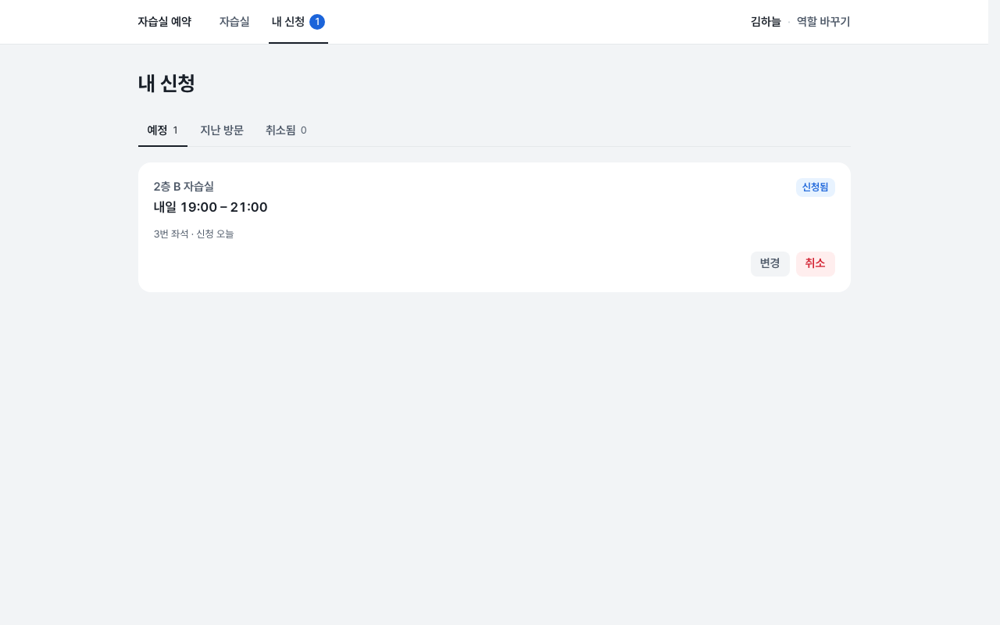
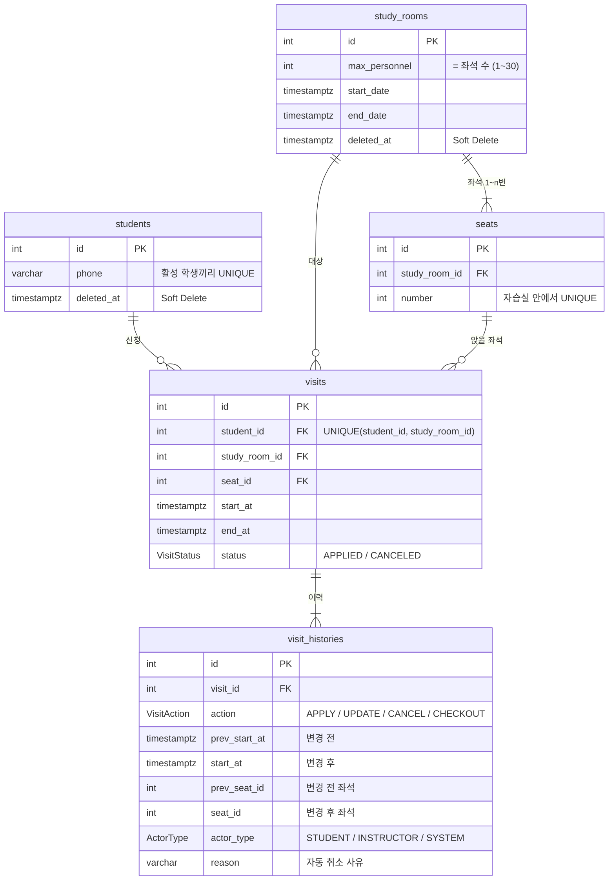

# 자습실 방문 예약 시스템

> 단톡방으로 받던 자습실 예약을 옮긴 **좌석 단위 예약 서비스**입니다.
> Vue 3 + NestJS + PostgreSQL 풀스택 모노레포 · 하이컨시 과제전형

```bash
docker compose up --build   # → 웹 http://localhost:8080 · API http://localhost:3000/api · Swagger /api/docs
```

[실행 방법](#1-프로젝트-실행-방법) · [기술 스택](#2-기술-스택-및-선택-이유) · [아키텍처](#3-아키텍처-및-컨벤션) · [DB 스키마](#4-데이터베이스-스키마) · [고민한 점](#5-개발-시-고민한-점--아쉬운-점) · [문서 지도](./docs/README.md)

## 무엇을 만들었나

| 역할     | 할 수 있는 일                                                                                                                 |
| -------- | ----------------------------------------------------------------------------------------------------------------------------- |
| **강사** | 자습실(좌석 수·운영 기간) 등록·수정·삭제, **시각별 좌석 배치도**로 누가 어디 앉는지 확인, 신청·변경·취소 이력 조회, 학생 관리 |
| **학생** | 방문 시간과 **좌석**을 골라 신청, 시간·좌석 변경, 취소·다시 신청, 방문 중 **조기 퇴실**                                       |

로그인 대신 첫 화면에서 강사/학생을 고릅니다(명세 허용). 과제 명세 정리: [docs/requirements.md](./docs/requirements.md)

### 화면

| 강사 · 자습실 목록                                                 | 강사 · 시각별 좌석 배치도                                          |
| ------------------------------------------------------------------ | ------------------------------------------------------------------ |
|    |  |
| **강사 · 이력 (좌석 변경·퇴실)**                                   | **학생 · 자습실 목록**                                             |
|        |   |
| **학생 · 시간과 좌석 고르기**                                      | **학생 · 내 신청 (방문 중 → 퇴실)**                                |
|  |      |

모바일(320px) 캡처: [강사](./docs/images/seat-teacher/) · [학생](./docs/images/seat-student/)

### 주요 기능

- **좌석 단위 예약** — 학생은 고른 시간 **내내 비어 있는 좌석만** 고를 수 있고, 같은 좌석은 시간이 겹치지 않게 예약됩니다.
- **강사 배치도** — 시각을 고르면 좌석마다 앉기로 한 학생이 보이고, 신청 학생을 누르면 그 좌석을 강조합니다. "지금"은 실제 현재 시각 기준입니다.
- **실시간에 가깝게** — 좌석 화면은 30초마다 다시 받고, 고른 좌석을 방금 다른 학생이 가져가면 알려 줍니다. 빈 좌석이 없으면 같은 시간에 빈 좌석이 있는 다른 자습실로 안내합니다.
- **기록이 남는다** — 신청·변경(`3번 → 7번 좌석`)·취소·퇴실이 모두 이력으로 남고, 시스템이 취소한 신청은 학생에게 사유와 함께 보입니다.

### 구현 범위

명세의 **필수 9개·선택 3개를 모두** 구현했습니다.

| 구분 | ID        | 요구사항                        | 구현 내용                                                       |
| ---- | --------- | ------------------------------- | --------------------------------------------------------------- |
| 필수 | FR-ROM-01 | 자습실 목록 (삭제 제외)         | 운영 기간·좌석 수·**지금 이용 중인 좌석**                       |
| 필수 | FR-ROM-02 | 자습실 등록                     | 최대 인원(1~30석)·운영 기간, 시작 < 종료 검사                   |
| 필수 | FR-ROM-03 | 자습실 상세 이력                | 시간순 이력(좌석 변경·퇴실 포함) + 시각별 좌석 배치도·신청 학생 |
| 필수 | FR-ROM-04 | 최대 인원·운영 기간 수정        | 예약이 남은 좌석 축소·기간 밖 신청이 생기면 거절                |
| 필수 | FR-ROM-05 | 자습실 삭제 (Soft Delete)       | 끝나지 않은 신청 자동 취소, 지난 방문은 기록으로 유지           |
| 필수 | FR-STD-01 | 학생 목록                       | 이름·전화번호 검색                                              |
| 필수 | FR-VST-01 | 방문 신청 (운영 기간·정원·중복) | 정원 = **같은 좌석의 시간 겹침 금지**, 트랜잭션 + 행 락         |
| 필수 | FR-VST-02 | 방문 시간 수정                  | 시간과 좌석을 함께 변경                                         |
| 필수 | FR-VST-03 | 방문 취소                       | 좌석이 바로 비고, 다시 신청하면 이전 좌석을 미리 선택           |
| 선택 | FR-VST-04 | 내 신청 목록                    | 예정 / 지난 방문 / 취소됨(사유)                                 |
| 선택 | FR-ROM-06 | 자습실 변경 시 기존 신청 처리   | 축소·기간 변경은 막고, 삭제는 자동 취소                         |
| 선택 | FR-STD-02 | 학생 등록·수정·삭제             | Soft Delete, 전화번호 정규화·중복 방지                          |

**명세 밖에서 더한 것**: 좌석 직접 선택(#15) · 같은 학생의 시간 겹침 방지(#13) · 조기 퇴실(#16) · 빈 좌석 있는 다른 자습실 안내 · 동시성 검증(락을 빼면 실패하는 것까지 확인) · 웹 E2E(데스크톱·320px)와 접근성 점검

### 직접 정한 규칙

명세만으로 정해지지 않는 부분은 아래처럼 정했습니다. 근거 전체: [requirements.md 9절](./docs/requirements.md#9-해석이-필요한-부분)

| #   | 항목           | 규칙                                                                                         | 이유                                                                            |
| --- | -------------- | -------------------------------------------------------------------------------------------- | ------------------------------------------------------------------------------- |
| 1   | 방문 시간      | 시작~종료 **구간**으로 신청, 구간 전체가 운영 기간 안 (30분 단위)                            | "7시에 가기로 했는데 8시로" — 시간대가 의미 있는 정보                           |
| 2   | **정원 기준**  | **최대 인원 = 좌석 수.** 같은 좌석의 유효 신청끼리 시간이 겹치면 안 됨                       | 아래 설명 참고                                                                  |
| 3   | 재신청         | 취소 후 같은 자습실에 다시 신청 가능 (중복 금지는 "유효 신청 1건" 기준)                      | 마음을 바꾼 학생을 막을 이유가 없음                                             |
| 4   | 이력 저장      | 신청(현재 상태)과 이력(이벤트)을 테이블로 분리                                               | 좌석·중복 검사와 이력 조회를 각각 단순하게                                      |
| 5   | 동시성         | 트랜잭션 + 자습실 행 `FOR UPDATE`로 검사와 저장을 원자적으로                                 | 같은 좌석을 동시에 골라도 한 명만 성공                                          |
| 6   | 과거 시간      | 시작이 지금 이후여야 신청·수정 가능                                                          | 지나간 사실을 바꾸지 못하게                                                     |
| 7   | 최대 인원 축소 | 큰 번호 좌석부터 없앰. 없어질 좌석에 끝나지 않은 예약이 있으면 **거절**                      | 학생 모르게 예약이 사라지지 않게                                                |
| 8   | 운영 기간 변경 | 유효 신청이 새 기간 밖으로 밀려나면 **거절**                                                 | 7번과 같음                                                                      |
| 9   | 자습실 삭제    | 허용. 끝나지 않은 신청만 자동 취소(사유 "자습실 삭제"), 지난 방문은 그대로                   | 강사의 명시적 의도, 다녀간 기록은 보존                                          |
| 10  | 학생 삭제·번호 | 끝나지 않은 신청 자동 취소. 휴대폰 번호만, `010-1234-5678`로 정규화, 활성 학생끼리 중복 불가 | 전화번호가 실질적 식별자                                                        |
| 11  | 신청 주체      | 로그인 대신 경로의 학생 id를 본인으로. 다른 학생 신청은 404                                  | 명세가 로그인 생략 허용, 존재 여부도 숨김                                       |
| 12  | 수정·취소 시점 | 이미 시작한 방문은 수정·취소 불가 (퇴실만 가능, #16)                                         | 이력과 실제가 어긋나지 않게                                                     |
| 13  | 시간 겹침      | 같은 학생의 신청끼리 구간이 겹치면 안 됨 (맞닿는 구간은 허용)                                | 한 사람이 두 곳에 있을 수 없음                                                  |
| 14  | ~~대기열~~     | 만들었다가 좌석 단위 예약으로 바꾸며 **제거** (#44)                                          | 다른 좌석·시간을 바로 고를 수 있음 → [기록](./docs/solutions/waitlist-offer.md) |
| 15  | 좌석 선택      | 신청·변경 때 학생이 좌석을 직접 고름. 이미 예약된 좌석이면 409 `SEAT_TAKEN`                  | 실제 자습실처럼 "몇 번 좌석"을 학생이 정함                                      |
| 16  | 조기 퇴실      | 진행 중인 방문은 퇴실 가능. 종료를 퇴실 시각으로 줄이고 이력에 "퇴실"                        | 일찍 나가도 좌석이 원래 종료까지 묶이지 않게                                    |

> **규칙 #2 — 정원을 "같은 시각의 인원"으로 해석한 이유**
> 명세는 "자습실별 신청 인원(취소 제외)은 최대 인원을 넘을 수 없다"입니다. 처음엔 글자 그대로(유효 신청 건수 ≤ 최대 인원) 구현했는데, **끝난 방문도 계속 자리를 차지**하고 **시간이 겹치지 않는 학생끼리도 정원을 나눠 써서** 비어 있는 저녁까지 마감으로 보였습니다. 실제 자습실은 좌석 단위로 운영되므로 "최대 인원 = 좌석 수", "신청 인원 = 같은 시각에 있는 인원"으로 해석해 좌석 단위 예약으로 바꿨습니다(#45). 어느 시각이든 앉아 있는 인원은 최대 인원을 넘지 않습니다. → [설계 기록](./docs/tbd/seat-based-reservation.md)

---

## 목차

1. [프로젝트 실행 방법](#1-프로젝트-실행-방법)
2. [기술 스택 및 선택 이유](#2-기술-스택-및-선택-이유)
3. [아키텍처 및 컨벤션](#3-아키텍처-및-컨벤션)
4. [데이터베이스 스키마](#4-데이터베이스-스키마)
5. [개발 시 고민한 점 / 아쉬운 점](#5-개발-시-고민한-점--아쉬운-점)

---

## 1. 프로젝트 실행 방법

### 방법 A. Docker로 전체 실행 (권장)

**필요한 것: Docker** (Node.js·pnpm 설치 없이 실행됩니다)

```bash
git clone https://github.com/JungMINI-developer/hiconsy-task.git
cd hiconsy-task
docker compose up --build
```

| 주소                           | 설명             |
| ------------------------------ | ---------------- |
| http://localhost:8080          | 웹 (nginx)       |
| http://localhost:3000/api      | API              |
| http://localhost:3000/api/docs | Swagger API 문서 |

- 시작할 때 **마이그레이션과 시드가 자동으로 적용**됩니다. 시드에는 실행 시각 기준 **지금 운영 중인 자습실**(D 자습실, 이용 중 2석)이 있어 바로 좌석 현황과 퇴실을 볼 수 있습니다. → [시드 내용](./docs/database.md#마이그레이션--시드)
- 둘러보기: 첫 화면에서 **강사**로 들어가 D 자습실을 열거나, **학생**(예: 정열심 — D 자습실에서 방문 중)으로 들어가 신청·퇴실을 해 보세요.
- 종료: `docker compose down` (DB 데이터까지 지우기: `docker compose down -v`)
- 포트가 겹치면 `cp .env.example .env` 후 `API_PORT`·`WEB_PORT`·`POSTGRES_PORT`를 바꿉니다.

### 방법 B. 로컬 개발 모드

**필요한 것: Node.js 24+, pnpm 12** (`corepack enable` 또는 `npm i -g pnpm@12`), Docker(DB용)

```bash
pnpm install                            # 의존성 설치 + Prisma Client 생성
cp apps/api/.env.example apps/api/.env
pnpm db:up                              # PostgreSQL 실행 (localhost:5434)
pnpm db:migrate                         # 마이그레이션
pnpm db:seed                            # 시드
pnpm dev                                # 웹 http://localhost:5173 + API http://localhost:3000/api
```

### 테스트

```bash
pnpm test        # 단위 테스트 (web, api)
pnpm test:e2e    # API e2e + 웹 E2E (pnpm db:up 필요)
pnpm lint        # lint
pnpm typecheck   # 타입 검사
```

| 종류    | 도구                            | 검증하는 것                                                                          |
| ------- | ------------------------------- | ------------------------------------------------------------------------------------ |
| 단위    | Vitest                          | 시간·좌석 계산, 검증, 컴포넌트 상태별 렌더                                           |
| API e2e | Vitest + Supertest + PostgreSQL | 모든 규칙과 에러 코드, **동시 요청**(같은 좌석·시간 겹침·교착 상태)                  |
| 웹 E2E  | Playwright (1280 + 320px)       | 강사·학생 전체 흐름, 좌석 선점, 30초 자동 갱신, 퇴실, 키보드 조작, 320px 가로 스크롤 |

- 웹 E2E는 처음 한 번 `pnpm --filter @hiconsy/web exec playwright install chromium`이 필요합니다. 단계별로 보려면 `pnpm test:e2e:ui`.
- 테스트는 개발 DB와 분리된 전용 DB(`hiconsy_test`, `hiconsy_web_e2e`)와 별도 포트를 써서 개발 서버를 켜 둔 채로 돌려도 됩니다.
- 모든 PR에서 GitHub Actions가 lint·타입 검사·단위 테스트·빌드, API e2e, 웹 E2E, Docker 빌드를 검증합니다.

<details>
<summary><b>환경변수</b></summary>

| 파일            | 읽는 곳                                | 필요 여부                       |
| --------------- | -------------------------------------- | ------------------------------- |
| `.env` (루트)   | `docker-compose.yml`                   | 선택. 없으면 기본값             |
| `apps/api/.env` | NestJS, Prisma CLI (마이그레이션·시드) | 로컬 개발 모드에서 필수         |
| `apps/web/.env` | Vite                                   | 선택. 비우면 `/api` 프록시 사용 |

| 루트 `.env` 값      | 기본값    | 대상                   |
| ------------------- | --------- | ---------------------- |
| `POSTGRES_USER`     | `hiconsy` | DB 사용자              |
| `POSTGRES_PASSWORD` | `hiconsy` | DB 비밀번호            |
| `POSTGRES_DB`       | `hiconsy` | DB 이름                |
| `POSTGRES_PORT`     | `5434`    | PostgreSQL 호스트 포트 |
| `API_PORT`          | `3000`    | Docker API 포트        |
| `WEB_PORT`          | `8080`    | Docker 웹 포트         |

Docker 실행에서는 API의 `DATABASE_URL`이 위 값으로 자동 조합됩니다. 로컬 개발 모드에서 DB 값·포트를 바꿨다면 `apps/api/.env`의 `DATABASE_URL`도 맞춰 주세요.

</details>

<details>
<summary><b>DB 직접 보기 (pgAdmin, DBeaver 등)</b></summary>

| 항목                | 값 (기본값)                                               |
| ------------------- | --------------------------------------------------------- |
| Host                | `localhost` (Docker의 pgAdmin이면 `host.docker.internal`) |
| Port                | `5434`                                                    |
| Database            | `hiconsy` (테스트: `hiconsy_test`)                        |
| Username / Password | `hiconsy` / `hiconsy`                                     |

GUI 없이 보려면 `pnpm --filter @hiconsy/api prisma:studio`.

</details>

---

## 2. 기술 스택 및 선택 이유

| 영역     | 기술                                                        | 선택 이유                                                                                                            |
| -------- | ----------------------------------------------------------- | -------------------------------------------------------------------------------------------------------------------- |
| 구조     | pnpm workspace + Turborepo                                  | FE·BE가 API 타입·에러 코드를 `packages/shared`로 함께 써서, 한쪽만 바꾸면 타입 검사에서 바로 드러남                  |
| Frontend | Vue 3 (Composition API), Vite, TypeScript                   | 과제 조건. 화면 로직을 composable로 나눠 재사용·테스트 (좌석 고르기, 시간 고르기, 자동 갱신, 퇴실)                   |
|          | Vue Router, Pinia, Axios                                    | 다이얼로그·모드를 URL 쿼리에 둬 새로고침에도 유지. 전역 상태는 역할·내 신청 배지만, 좌석은 캐시하지 않고 다시 조회   |
|          | Tailwind CSS 4, Reka UI                                     | 디자인 토큰으로 일관된 스타일, 헤드리스 UI로 다이얼로그·셀렉트의 **접근성 동작**(포커스·키보드)을 검증된 구현에 맡김 |
| Backend  | NestJS                                                      | 과제 조건. 도메인별 모듈, DTO 검증, Swagger, Interceptor·Filter로 응답 형식 통일                                     |
|          | Prisma 7                                                    | 스키마 하나에서 모델·마이그레이션·타입 생성 → DB와 코드 타입이 어긋나지 않음                                         |
|          | PostgreSQL 16                                               | 동시 신청을 **행 락**(`FOR UPDATE` / `FOR NO KEY UPDATE`)으로 다룸. 부분 유니크 인덱스, CHECK 제약, `timestamptz`    |
| 테스트   | Vitest, Supertest, Playwright                               | 단위·API e2e(실제 PostgreSQL)·웹 E2E(실제 브라우저)를 각각 맞는 도구로                                               |
| 품질     | oxlint + ESLint, Prettier, husky·commitlint, GitHub Actions | 커밋 단계에서 포맷·컨벤션 강제, PR마다 4종 검증                                                                      |
| 인프라   | Docker Compose, nginx                                       | 평가자 로컬에서 **명령 한 번**으로 그대로 실행 (마이그레이션·시드 자동)                                              |

자세한 이유와 버전: [docs/tech-stack.md](./docs/tech-stack.md)

---

## 3. 아키텍처 및 컨벤션

### 3-1. 인프라

```
Browser ──▶ web (nginx :8080) ── /api/* ──▶ api (NestJS :3000) ──▶ postgres (:5432)
             └ Vue SPA 정적 파일              ├ 시작 시 migrate deploy + seed
                                              └ /api/docs (Swagger)
```

웹은 개발(Vite 프록시)·Docker(nginx 프록시) 모두 같은 origin의 `/api`만 호출해 환경별 분기가 없습니다.

### 3-2. 소스 코드 구조

```
apps/
  api/                # NestJS
    src/
      study-rooms/    #   자습실 (등록·수정·삭제, 이력·신청 학생 조회, 자습실 행 락)
      seats/          #   좌석 (겹침 검사, 좌석 현황·시각별 배치도·빈 좌석 조회)
      visits/         #   방문 신청·변경·취소·퇴실, 내 신청, 시스템 자동 취소
      students/       #   학생 (전화번호 정규화, 학생 행 락)
      common/         #   예외·응답 포맷(Interceptor/Filter)
    prisma/           #   스키마·마이그레이션·시드
    test/             #   API e2e
  web/                # Vue 3
    src/
      views/          #   화면 (teacher/, student/)
      components/     #   ui/(공통, Reka UI 래퍼) · domain/(좌석 배치도·이력 타임라인 등)
      composables/    #   화면 로직 (useSeatPicker, useAutoRefresh, useVisitCheckout …)
      api/ stores/ utils/
    e2e/              #   Playwright
    docs/             #   화면 명세·사용자 흐름·문구·디자인 시스템
packages/shared/      # FE·BE 공유: API 요청·응답 타입, 에러 코드, 상수
docs/                 # 설계 문서 → docs/README.md
```

### 3-3. 요청 흐름과 응답 규약

- `Controller → Service → Prisma → PostgreSQL`. 컨트롤러는 데이터만 반환하고, 응답 형식은 Interceptor·Exception Filter가 맞춥니다.
- 성공 `{ success: true, data }` / 실패 `{ success: false, error: { code, message, details? } }`. 도메인 규칙 위반은 `error.code`(예: `SEAT_TAKEN`, `VISIT_TIME_OVERLAP`)로 구분하고, 웹은 코드별로 안내·재조회를 정합니다.
- 시간은 DB에 `timestamptz`, API 응답은 KST 오프셋 ISO 8601(`2026-11-20T19:00:00.000+09:00`)입니다.

### 3-4. 동시성 — 같은 좌석을 두 명이 동시에 고르면?

"비었는지 확인 → 저장" 사이에 다른 요청이 끼어들 수 없도록, 신청 정보를 바꾸는 모든 작업이 **한 트랜잭션에서 학생 → 자습실 순서로 행 락**을 잡습니다.

| 작업                       | 학생 행             | 자습실 행    | 막는 것                                  |
| -------------------------- | ------------------- | ------------ | ---------------------------------------- |
| 신청·재신청·시간/좌석 변경 | `FOR NO KEY UPDATE` | `FOR UPDATE` | 같은 좌석 이중 예약, 같은 학생 시간 겹침 |
| 취소·퇴실                  | `FOR SHARE`         | `FOR UPDATE` | 학생 삭제와 엇갈림                       |
| 자습실 수정·삭제           | -                   | `FOR UPDATE` | 좌석 축소·기간 변경과 신청의 엇갈림      |

- **검증**: 같은 좌석에 10명이 동시에 신청하면 1명만 성공합니다. 락을 빼고 돌리면 **10명 모두 성공**해 테스트가 실패하는 것까지 확인했습니다.
- 학생 락을 `FOR UPDATE`가 아닌 `FOR NO KEY UPDATE`로 둔 이유는 자습실 삭제가 이력을 넣을 때의 FK 검사와 교착 상태가 생기기 때문입니다(테스트로 `deadlock detected` 재현).
- 문제별 기록: [docs/solutions](./docs/solutions/) · 전체 구조·API 목록: [docs/architecture.md](./docs/architecture.md)

### 3-5. 컨벤션

| 항목      | 규칙                                                                                                                                 |
| --------- | ------------------------------------------------------------------------------------------------------------------------------------ |
| 작업 흐름 | 이슈 → `dev`에서 `feat/#이슈-설명` 브랜치 → `dev`로 PR(Squash) → 릴리스는 `dev` → `main`(Merge commit)                               |
| 커밋      | Conventional Commits, `feat(api): 진행 중인 방문 조기 퇴실 API (#66)` — commitlint가 커밋 시 검사                                    |
| 코드      | Prettier 공통 포맷, 공유 타입은 `packages/shared`, BE는 Controller(요청·응답)와 Service(로직) 분리, FE는 API 호출을 `src/api`에 모음 |
| 검증      | PR 전 `pnpm lint && pnpm typecheck && pnpm test`, CI가 4종 검증                                                                      |

전체 컨벤션: [CONTRIBUTING.md](./CONTRIBUTING.md)

---

## 4. 데이터베이스 스키마



| 테이블            | 역할                                                                    |
| ----------------- | ----------------------------------------------------------------------- |
| `students`        | 학생 (필수 엔티티, Soft Delete)                                         |
| `study_rooms`     | 자습실 (필수 엔티티, Soft Delete). 최대 인원 = 좌석 수                  |
| `seats`           | 자습실의 좌석 1~n번. 좌석 수를 줄여도 행은 지우지 않음                  |
| `visits`          | 방문 신청의 **현재 상태**. 학생-자습실 쌍당 1행                         |
| `visit_histories` | 신청·변경·취소·퇴실 **이벤트 로그** (append-only, 변경 전·후 시간·좌석) |

### 설계 이유

1. **신청(현재 상태)과 이력(이벤트)을 나눴습니다.** 좌석·중복 검사는 "지금 유효한 신청"만 빠르게 찾아야 하고, 이력 조회는 "무슨 일이 언제 있었는지"를 시간순으로 봐야 합니다. 한 테이블로 합치면 검사마다 최신 행을 찾는 서브쿼리가 필요하고 유니크 제약으로 중복을 막을 수 없습니다. 두 테이블은 같은 트랜잭션에서 함께 씁니다.
2. **`UNIQUE(student_id, study_room_id)` + 상태 전환으로 중복 신청을 막습니다.** 취소는 행을 지우지 않고 `CANCELED`로, 재신청은 같은 행을 `APPLIED`로 되돌립니다. 부분 인덱스 없이 일반 유니크 제약만으로 DB가 중복을 막고, 취소해도 좌석 기록이 남아 재신청 때 이전 좌석을 미리 고릅니다.
3. **이력에 변경 전·후 값을 함께 저장합니다.** 다른 행을 찾지 않고도 `19:00 – 21:00 → 19:00 – 20:47`, `3번 → 7번 좌석`을 만들 수 있고, 자습실·학생 id를 이력에도 둬(비정규화) 자습실별 이력을 인덱스로 바로 조회합니다. 이력은 불변이라 갱신 이상이 없습니다.
4. **좌석은 줄여도 지우지 않습니다.** `number > max_personnel`인 좌석을 "쓰지 않는 좌석"으로 봐서, 지난 신청·이력이 같은 좌석을 계속 가리키고 다시 늘리면 같은 번호를 그대로 씁니다.
5. **같은 좌석·같은 학생의 시간 겹침은 DB 배제 제약 대신 행 락 + 서비스 로직**으로 막습니다. `EXCLUDE USING gist`는 Prisma 스키마로 표현할 수 없어 스키마와 DB가 어긋났다고 판단될 위험이 있었습니다. 대신 락을 빼면 실패하는 테스트로 보장을 고정했습니다.
6. **삭제는 Soft Delete, 모든 FK는 `ON DELETE RESTRICT`**입니다. 자습실·학생을 지우면 끝나지 않은 신청만 자동 취소하고, 이미 다녀간 방문은 기록으로 남깁니다.

ERD 전체(컬럼·제약·인덱스·enum·상태 흐름): [docs/database.md](./docs/database.md)

---

## 5. 개발 시 고민한 점 / 아쉬운 점

### 고민한 점

- **명세를 글자 그대로 구현한 뒤, 해석을 바꿨습니다.** 정원을 "유효 신청 건수 ≤ 최대 인원"으로 만들었다가, 끝난 방문도 자리를 차지하고 저녁까지 마감으로 보이는 문제를 보고 좌석 단위 예약으로 바꿨습니다(규칙 #2). 범위가 커서 설계 문서로 결정을 먼저 확정하고 대기열 제거 → 좌석 모델·API → 학생 화면 → 강사 화면 → 문서 순으로 나눴고, 기존 데이터는 마이그레이션에서 겹치지 않는 좌석에 배정해 옮겼습니다.
- **트랜잭션만으로는 동시 신청이 막히지 않습니다.** "확인 → 저장" 사이의 경쟁 상태를 행 락으로 막고, 테스트가 정말 경쟁을 잡는지 확인하려고 **락을 빼고 실패하는 것**까지 봤습니다. 또 "누가 이기는가(공정성)"는 동시성 제어와 별개의 정책으로 보고 서버 도착 기준 선착순으로 정리했습니다.
- **락 모드 하나가 교착 상태를 만듭니다.** 다른 자습실끼리의 시간 겹침을 막으려 학생 행을 잠갔는데, `FOR UPDATE`는 FK 검사와 충돌해 교착 상태가 났습니다. `FOR NO KEY UPDATE`로 바꾸고, 되돌리면 실패하는 테스트로 고정했습니다.
- **화면은 막고, 판단은 서버가 합니다.** 겹치는 시간·예약된 좌석은 선택지에서 미리 막되, 화면 데이터는 낡을 수 있어 최종 판단은 서버가 하고 화면은 에러 코드별로 "알리고 다시 조회"합니다.
- **규칙이 바뀌면 화면의 숫자도 같은 기준이어야 합니다.** 강사 목록의 "예약 14건"이 좌석 10석보다 커 보여 "지금 이용 중인 좌석"으로 바꿨고, 퇴실이 생긴 뒤에는 상세의 "지금" 배치도도 실제 현재 시각 기준으로 맞췄습니다.
- **평가자와 같은 조건으로 점검했습니다.** GitHub에서 새로 clone해 Docker로 띄운 뒤 브라우저로 전체 기능을 눌러 보며, 개발 환경에서는 안 보이던 문제(UTC 컨테이너에서 시드 시각이 9시간 밀림, 320px 헤더 넘침 등)를 찾아 고쳤습니다.

### 아쉬운 점

- **인증이 없습니다.** 명세대로 역할을 화면에서 고르고 API는 경로의 학생 id를 본인으로 봅니다. 실서비스라면 로그인과 소유권 검증이 먼저 필요합니다.
- **알림이 없습니다.** 자습실 삭제로 신청이 자동 취소돼도 학생은 앱을 열어야 압니다.
- **좌석 단편화가 있습니다.** 매 순간 한 자리씩 비어 있어도 고른 시간 **내내** 빈 좌석이 없으면 신청할 수 없습니다. 다른 시간·자습실을 안내하지만, 좌석을 옮겨 앉는 예약은 만들지 않았습니다.
- **실제 재석은 모릅니다.** 배치도는 예약(언제 오기로 했는지)만 보여줍니다. 입·퇴실 체크가 없어 외출·조퇴 같은 실제 상태는 다루지 않았습니다.
- **고부하는 150명 동시 요청까지만 확인했습니다.** 수천 건이 몰리면 락보다 커넥션 풀·트랜잭션 대기가 먼저 한계가 됩니다.

전체 기록: [docs/retrospective.md](./docs/retrospective.md)

---

모든 문서의 위치와 역할: [docs/README.md](./docs/README.md)
