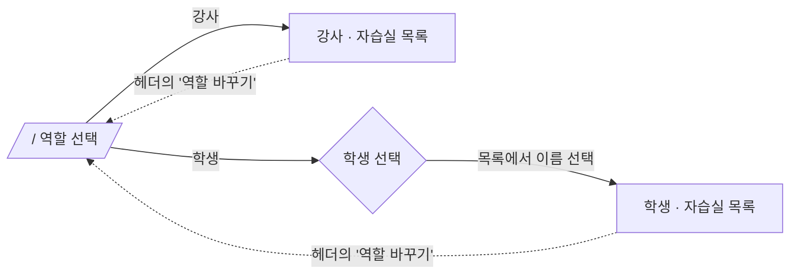
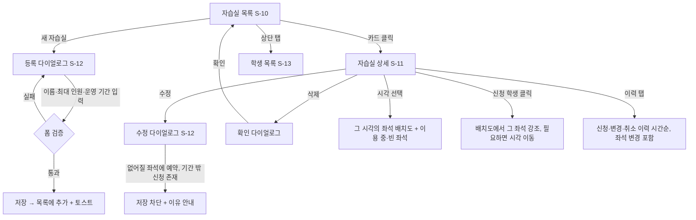
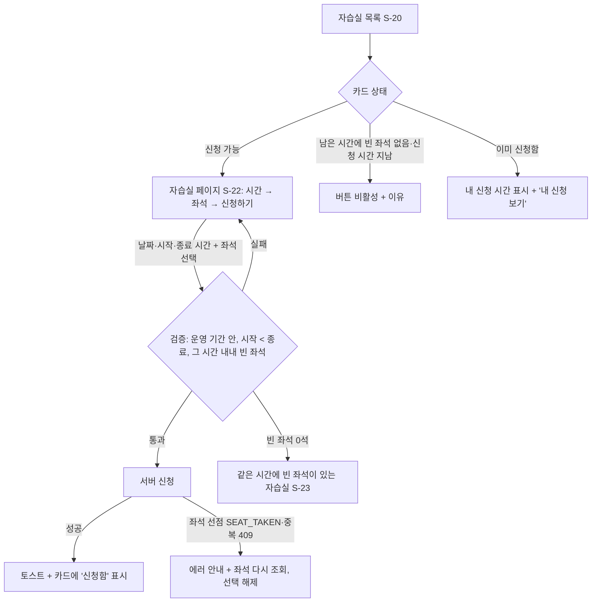
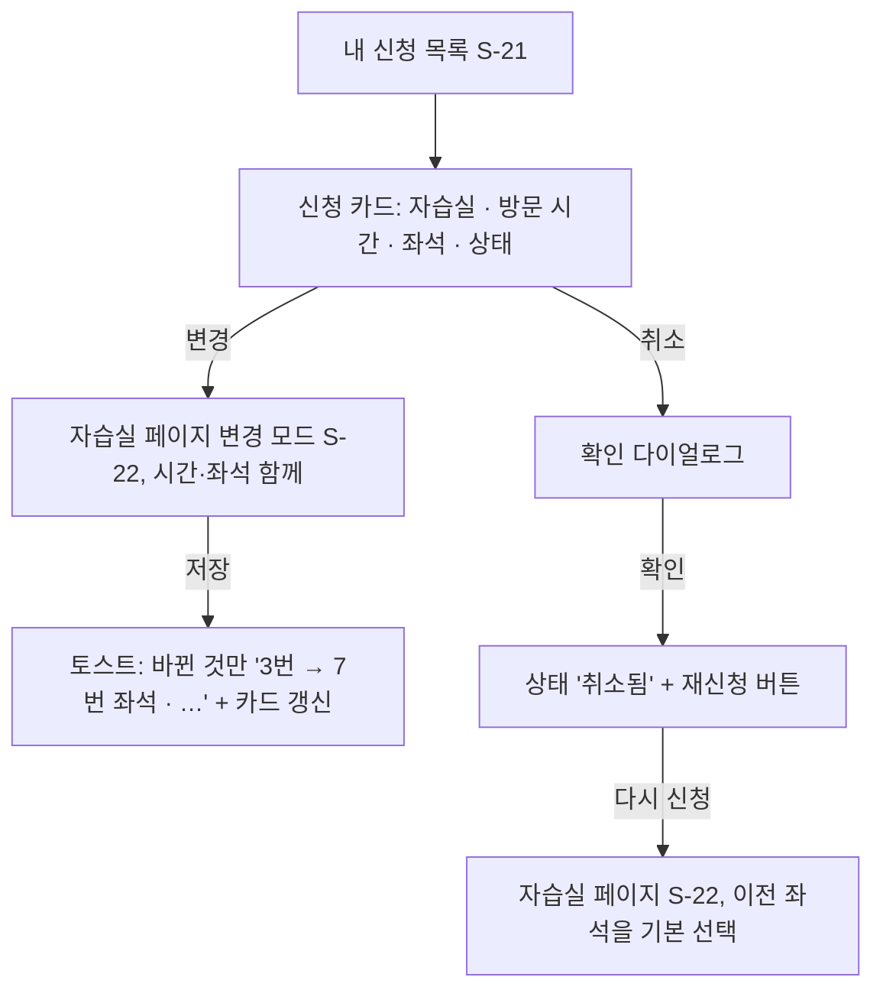

# 사용자 흐름

## 사용자와 해결할 문제

| 사용자 | 현장의 목소리                                         | UI가 줘야 할 답                                    | 핵심 화면  |
| ------ | ----------------------------------------------------- | -------------------------------------------------- | ---------- |
| 강사   | "자습실 열 때마다 공지 올리고 인원 세는 게 일이에요." | 폼 하나로 공개하고, 목록에서 신청 인원을 바로 본다 | S-10, S-11 |
| 학생   | "신청은 했는데 제가 명단에 있는 건지 모르겠어요."     | 자습실 카드와 내 신청 목록에 내 상태가 보인다      | S-20, S-21 |
| 학생   | "7시에 가기로 했는데 8시로 바꾸려면 누구한테 말해요?" | 본인이 직접 시간을 바꾸고, 바뀐 결과를 확인한다    | S-21       |

화면 ID(S-xx)는 [screens.md](./screens.md)를 참고합니다.

## 0. 진입 — 역할 선택 (로그인 대체)

로그인은 생략합니다(요구사항 3절). 첫 화면에서 역할을 고르고, 학생은 **어떤 학생인지**도 고릅니다. 선택한 학생 id가 "본인"을 판별하는 기준입니다(requirements 9절 #11).

- 선택 결과는 Pinia 스토어 + `localStorage`에 저장해 새로고침해도 유지합니다.
- 역할 없이 `/teacher/*`, `/student/*`에 들어오면 `/`로 보냅니다(라우터 가드).

## 1. 강사 — 자습실 공개와 좌석 현황 관리

## 2. 학생 — 방문 신청

## 3. 학생 — 내 신청 확인·수정·취소

- 취소한 신청도 목록에 남겨(흐리게) "내가 취소했다"는 사실을 확인할 수 있게 합니다. 취소 후 재신청은 허용합니다(requirements 9절 #3).

## 범위

| 구분 | 흐름                                                                        |
| ---- | --------------------------------------------------------------------------- |
| MVP  | 0, 1(등록·수정·삭제·이력), 2, 3, 학생 목록 조회                             |
| 선택 | 학생 등록·수정·삭제(FR-STD-02), 자습실 변경 시 기존 신청 처리 UI(FR-ROM-06) |
