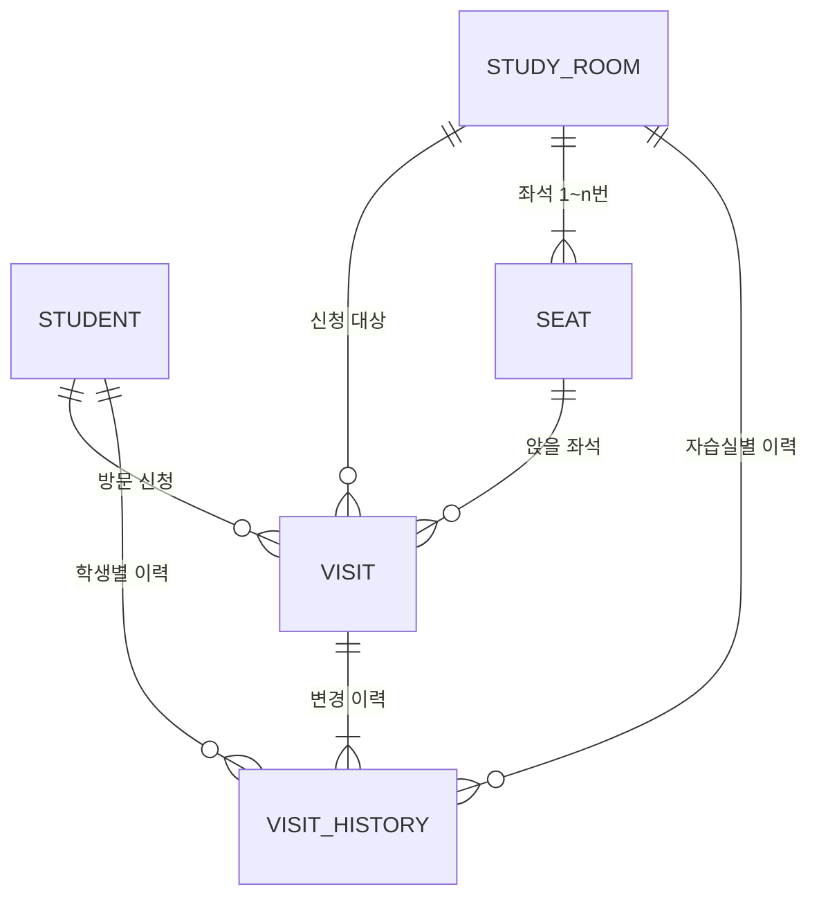
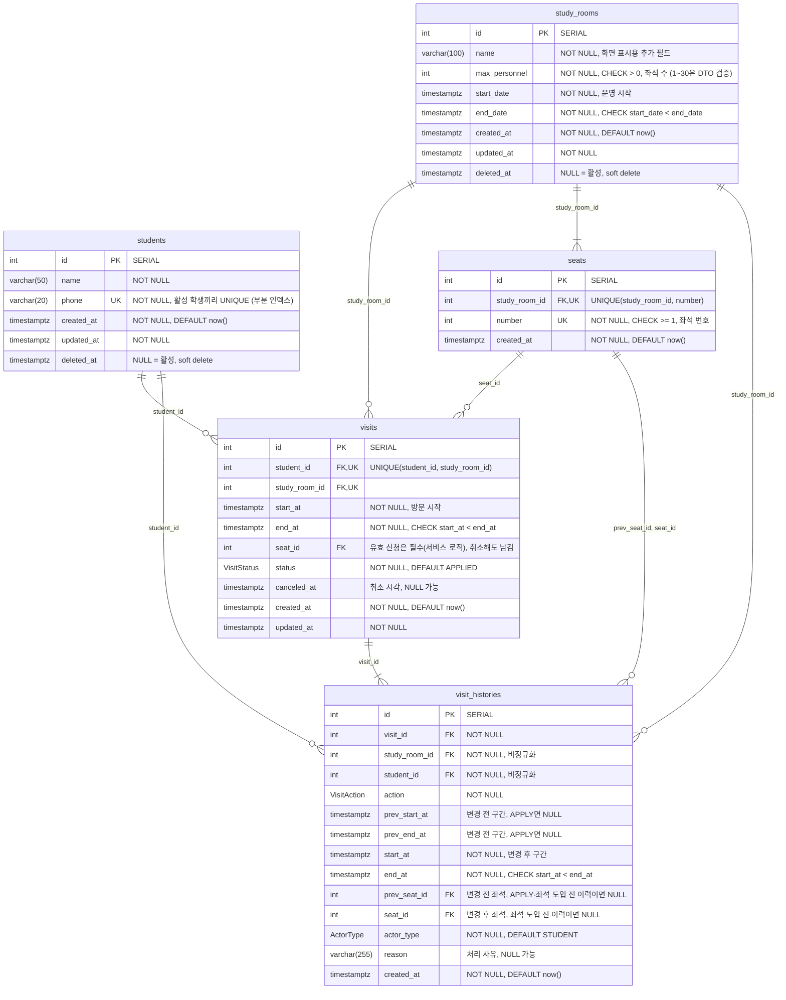
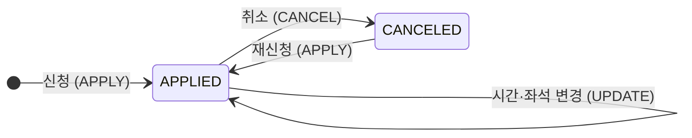

# 데이터베이스 스키마

- DBMS: PostgreSQL 16, ORM: Prisma 7
- 스키마: [`apps/api/prisma/schema.prisma`](../apps/api/prisma/schema.prisma)
- 테이블·컬럼명은 `snake_case`(`@@map`/`@map`), 코드에서는 `camelCase`로 다룬다.
- 일시는 모두 `timestamptz(3)`로 저장한다 (타임존 오해 방지, 밀리초 정밀도).

## ERD

### 관계 개요

- 학생 1명은 여러 자습실에 신청할 수 있고, 자습실 1개에는 여러 학생이 신청한다 → `visits`가 N:M을 풀어주는 테이블이다.
- 같은 학생-자습실 쌍의 신청은 1행뿐이다 (`UNIQUE(student_id, study_room_id)`). 취소 후 재신청은 이 행의 상태를 되돌린다.
- 자습실의 최대 인원 = 좌석 수다. 좌석은 자습실마다 1번부터 번호가 붙고, 신청은 좌석 하나를 차지한다(#45). 같은 좌석의 유효 신청끼리는 시간이 겹치면 안 된다.
- 신청 1건에는 이력이 1건 이상 있다 (최초 `APPLY`). 이력은 자습실·학생 기준으로도 바로 조회할 수 있게 FK를 함께 가진다.

### 상세 ERD

> 표기: `||--o{` 1:0..N, `||--|{` 1:1..N / `PK` 기본키, `FK` 외래키, `UK` 복합 유니크 구성 컬럼.
> 모든 FK는 `ON DELETE RESTRICT`이다.

### Enum

| Enum          | 값                                | 사용 컬럼                    | 의미                                                           |
| ------------- | --------------------------------- | ---------------------------- | -------------------------------------------------------------- |
| `VisitStatus` | `APPLIED`, `CANCELED`             | `visits.status`              | 유효 신청 / 취소. `APPLIED`만 좌석을 차지                      |
| `VisitAction` | `APPLY`, `UPDATE`, `CANCEL`       | `visit_histories.action`     | 신청(재신청 포함) / 시간·좌석 변경 / 취소                      |
| `ActorType`   | `STUDENT`, `INSTRUCTOR`, `SYSTEM` | `visit_histories.actor_type` | 이력을 남긴 주체. `SYSTEM`은 자습실 변경·삭제에 따른 자동 처리 |

### 상태 흐름

상태가 바뀔 때마다 `visit_histories`에 해당 action으로 1행이 쌓인다.

## 테이블 설명

| 테이블            | 역할                                                 | 비고                                                                               |
| ----------------- | ---------------------------------------------------- | ---------------------------------------------------------------------------------- |
| `students`        | 학생 (필수 엔티티)                                   | Soft Delete                                                                        |
| `study_rooms`     | 자습실 (필수 엔티티). 최대 인원(= 좌석 수)·운영 기간 | Soft Delete. 화면 표시용 `name` 추가                                               |
| `seats`           | 자습실의 좌석 1~n번                                  | 최대 인원을 줄여도 행을 지우지 않음 (설계 이유 9)                                  |
| `visits`          | 방문 신청의 **현재 상태**                            | 학생-자습실 쌍당 1행. 좌석 겹침 검사·내 신청 목록의 기준                           |
| `visit_histories` | 신청·수정·취소 **이벤트 로그** (append-only)         | 변경 전/후 방문 구간·좌석, 행위 주체, 사유. 자습실 상세의 이력 타임라인(FN-ROM-03) |

## 설계 이유

### 1. 신청(`visits`)과 이력(`visit_histories`) 분리

"신청·수정·취소 이력은 모두 남는다"는 규칙과 "좌석·중복 검사"는 요구하는 데이터 모양이 다르다.

- **좌석·중복 검사**는 _지금 유효한 신청_ 만 빠르게 찾아야 한다 → `visits`는 현재 상태만 가진다.
- **이력 조회**는 _무슨 일이 언제 있었는지_ 를 시간순으로 봐야 한다 → `visit_histories`는 이벤트를 쌓기만 하고 수정·삭제하지 않는다.

이력을 한 테이블에 행으로 쌓아 "가장 최신 행 = 현재 상태"로 쓰는 방식도 가능하지만, 좌석 검사마다 신청별 최신 행을 찾는 서브쿼리가 필요해지고 유니크 제약으로 중복을 막을 수 없다. 반대로 상태 테이블 하나만 두면 이력이 사라진다. 두 테이블을 분리하고 **같은 트랜잭션에서 함께 쓰는 것**으로 일관성을 보장한다.

### 2. 중복 신청 방지와 재신청: `UNIQUE(student_id, study_room_id)` + 상태 전환

규칙: 같은 학생은 한 자습실에 유효 신청 1건만 가질 수 있고, 취소 후에는 다시 신청할 수 있다.

- 취소는 행을 지우지 않고 `status = CANCELED`로 바꾼다.
- 재신청은 새 행을 만들지 않고 **기존 행을 `APPLIED`로 되돌리고 새 방문 구간·좌석을 저장**한다. 이력에는 `APPLY` 이벤트가 다시 쌓인다. 취소해도 `seat_id`를 남겨 두어 재신청할 때 이전 좌석을 기본으로 고른다.
- 덕분에 PostgreSQL 부분 유니크 인덱스(`WHERE status = 'APPLIED'`) 없이 **일반 복합 유니크 제약만으로 DB 레벨에서 중복이 막힌다** (Prisma 스키마로 그대로 표현 가능, 동시 요청에도 안전).

### 3. 방문 시간은 구간(`start_at`, `end_at`)

학생 피드백("7시에 가기로 했는데 8시로 바꾸려면…")과 자습실 운영 기간이 구간이라는 점을 반영했다. 신청 구간은 자습실 운영 기간 안에 있어야 하며(애플리케이션 검증), `start_at < end_at`은 DB CHECK로도 보장한다. 좌석 단위 예약(#45)으로 바꿀 때도 이 구간 데이터를 그대로 써서 "같은 좌석의 구간 겹침"을 검사한다.

### 4. 정원(좌석 겹침) 동시성 제어

정원은 **같은 좌석의 유효 신청끼리 방문 구간이 겹치지 않는 것**이다(requirements 9절 #2·#15). 반열린 구간 `[start_at, end_at)`으로 보므로 18~20시 다음 20~22시는 같은 좌석을 쓸 수 있다. "겹치는 신청 찾기 → 저장"은 두 요청이 동시에 오면 둘 다 통과할 수 있으므로 다음처럼 처리한다.

1. 트랜잭션 시작
2. `SELECT ... FROM study_rooms WHERE id = ? FOR UPDATE`로 **자습실 행에 락**을 건다 → 같은 자습실의 신청·재신청·시간·좌석 변경·좌석 축소가 직렬화된다
3. 고른 좌석이 그 자습실의 쓰는 좌석(`number <= max_personnel`)인지, 그 좌석에 `start_at < 새 종료 AND end_at > 새 시작`인 유효 신청이 없는지 검사(`visits (seat_id, status, start_at)` 인덱스) 후 `visits`·`visit_histories` 저장
4. 커밋 (락 해제)

락 범위가 "자습실 1행"이라 다른 자습실 신청은 막지 않는다. 좌석마다 락을 거는 방법도 있지만, 좌석 축소처럼 여러 좌석을 함께 보는 작업과 순서를 맞춰야 해서 기존 자습실 락을 그대로 쓰는 쪽을 택했다. 락은 `lockStudyRoom()`(`apps/api/src/study-rooms/study-room-lock.ts`)으로 신청·재신청·시간·좌석 변경·취소와 자습실 수정·삭제에 적용되어 있다. 같은 좌석 동시 예약의 검증과 대안 비교는 [solutions/seat-reservation-concurrency.md](./solutions/seat-reservation-concurrency.md), 좌석 전환 전(자습실 단위 정원)의 락 비교·공정성은 [solutions/study-room-capacity-concurrency.md](./solutions/study-room-capacity-concurrency.md)에 정리했다.

같은 좌석의 겹침도 PostgreSQL 배제 제약으로 DB가 보장하게 할 수 있지만, 아래 학생 시간 겹침과 같은 이유(Prisma 스키마로 표현할 수 없음)로 서비스 로직 + 락으로 맞췄다.

#### 같은 학생의 시간 겹침 방지

같은 학생의 유효 신청끼리는 방문 구간이 겹치면 안 된다(requirements 9절 #13). 자습실이 다르면 자습실 락이 서로 달라 막지 못하므로, 신청·시간 수정은 **학생 행을 `FOR NO KEY UPDATE`로 잠근 뒤** `start_at < 새 종료 AND end_at > 새 시작`인 유효 신청이 있는지 검사한다. 조회는 `UNIQUE(student_id, study_room_id)` 인덱스의 앞 컬럼(`student_id`)을 탄다.

PostgreSQL 배제 제약(`EXCLUDE USING gist (student_id WITH =, tstzrange(start_at, end_at) WITH &&) WHERE (status = 'APPLIED')`)이면 DB가 직접 보장하지만, `btree_gist` 확장이 필요하고 Prisma 스키마로 표현할 수 없어 마이그레이션 SQL을 손으로 관리해야 한다(스키마와 DB가 어긋났다고 판단할 위험). 좌석 겹침과 같은 방식(트랜잭션 + 행 락)으로 맞추는 쪽을 택했다.

### 5. 이력 테이블의 비정규화와 확장 필드

- `study_room_id`, `student_id`를 이력에도 둔다. `visits`를 거치지 않고 "자습실별 이력(FN-ROM-03)"과 "학생별 이력"을 시간순 인덱스(`(study_room_id, created_at)`, `(student_id, created_at)`)로 바로 조회하기 위해서다. 이력은 불변 데이터라 비정규화로 인한 갱신 이상이 없다.
- `prev_start_at`/`prev_end_at`과 `start_at`/`end_at`, `prev_seat_id`와 `seat_id`로 **변경 전후 값**을 함께 저장해, 다른 행을 찾아보지 않고도 "19시 → 20시로 변경", "3번 → 7번 좌석" 같은 문장을 만들 수 있다.
- `actor_type`(STUDENT / INSTRUCTOR / SYSTEM)과 `reason`은 신청 당사자가 아닌 쪽의 변경으로 신청이 처리될 때를 위해 둔다. 자습실·학생이 삭제되면 유효 신청을 `SYSTEM` + "자습실 삭제" / "학생 삭제" 사유로 취소한다.

### 6. 삭제 정책

- `students`, `study_rooms`는 명세대로 **Soft Delete**(`deleted_at`). 조회 시 `deleted_at IS NULL` 조건을 붙이며, 이를 위한 인덱스를 둔다.
- 모든 FK는 `ON DELETE RESTRICT`. 물리 삭제를 하지 않는 정책이므로 실수로 지워져 이력이 연쇄 삭제되는 일을 DB 단에서 막는다.
- `visits`에는 `deleted_at`을 두지 않았다. 신청의 "삭제"는 도메인상 취소(`CANCELED`)이기 때문이다.
- 자습실·학생을 삭제하면 연결된 **끝나지 않은**(진행 중 포함, `end_at > now`) 유효 신청을 같은 트랜잭션에서 자동 취소하고 이력을 남긴다. 삭제된 대상에 앞으로의 신청이 남지 않아 좌석·목록 계산이 단순해진다.
- 이미 끝난 방문은 `APPLIED` 그대로 둔다(#57). 다녀간 방문을 "취소"로 바꾸면 지나간 사실이 바뀌기 때문이다. 그래서 학생 "내 신청"의 지난 방문과, 강사 자습실 상세의 신청 학생·그 시각 배치도에 삭제된 자습실·학생의 지난 방문이 기록으로 남는다. 강사 화면 응답(신청 학생·이력·배치도)의 학생에는 `deletedAt`을 함께 내려 "탈퇴한 학생"으로 표시한다(#61).

### 7. 제약조건 정리

| 대상          | 제약                                               | 위치                                        |
| ------------- | -------------------------------------------------- | ------------------------------------------- |
| `study_rooms` | `max_personnel > 0`                                | DB CHECK                                    |
| `study_rooms` | `start_date < end_date`                            | DB CHECK + DTO 검증                         |
| `visits`      | `start_at < end_at`                                | DB CHECK + DTO 검증                         |
| `visits`      | 학생-자습실 1행                                    | DB UNIQUE                                   |
| `students`    | 활성 학생끼리 전화번호 중복 불가                   | DB 부분 UNIQUE (`WHERE deleted_at IS NULL`) |
| `visits`      | 방문 구간 ⊂ 자습실 운영 기간                       | 서비스 로직                                 |
| `seats`       | 자습실 안에서 좌석 번호 유일                       | DB UNIQUE                                   |
| `seats`       | `number >= 1`                                      | DB CHECK                                    |
| `study_rooms` | `max_personnel` 1~30                               | DTO 검증 (기존 자습실 이전을 위해 DB는 > 0) |
| `visits`      | 같은 좌석의 유효 신청끼리 구간 겹침 금지           | 서비스 로직 (트랜잭션 + 자습실 락)          |
| `visits`      | 유효 신청은 쓰는 좌석(`number <= max_personnel`)에 | 서비스 로직                                 |
| `study_rooms` | 없어질 좌석에 끝나지 않은 예약이 있으면 축소 불가  | 서비스 로직 (409 `SEATS_IN_USE`)            |
| `visits`      | 삭제된 자습실·학생에는 신청 불가                   | 서비스 로직                                 |

전화번호 부분 유니크 인덱스는 Prisma의 `partialIndexes` 프리뷰 기능(`@@unique(..., where: { deletedAt: null })`)으로 스키마에 표현했다. Soft Delete와 유니크 제약을 함께 쓰면 삭제된 행이 번호를 계속 점유하는 문제가 생기는데, 부분 인덱스로 이를 DB 레벨에서 해결한다.

CHECK 제약은 Prisma 스키마 문법으로 표현할 수 없어 마이그레이션 SQL에 직접 추가했다. Prisma는 CHECK 제약을 비교 대상으로 보지 않으므로 이후 마이그레이션에서 지워지지 않는다(drift 확인 완료).

### 8. 인덱스

| 인덱스                                             | 용도                                                     |
| -------------------------------------------------- | -------------------------------------------------------- |
| `visits (student_id, study_room_id)` UNIQUE        | 중복 신청 방지, 내 신청 목록                             |
| `visits (study_room_id, status)`                   | 자습실별 유효 신청 조회 (목록·지금 이용 중 좌석)         |
| `visits (seat_id, status, start_at)`               | 좌석별 시간 겹침 검사, 시각별 좌석 배치도                |
| `seats (study_room_id, number)` UNIQUE             | 자습실의 좌석 번호 유일, 번호 범위로 쓰는 좌석 조회      |
| `visit_histories (study_room_id, created_at)`      | 자습실 상세 이력 시간순 조회                             |
| `visit_histories (student_id, created_at)`         | 학생별 이력 조회                                         |
| `visit_histories (visit_id)`                       | 신청 단건 이력                                           |
| `study_rooms (deleted_at, start_date)`             | 삭제 제외 목록 + 운영 시작일 정렬                        |
| `students (deleted_at)`                            | 삭제 제외 학생 목록                                      |
| `students (phone) WHERE deleted_at IS NULL` UNIQUE | 활성 학생 전화번호 중복 방지 (삭제된 번호는 재사용 가능) |

### 9. 좌석 (`seats`) — #45

- **최대 인원 = 좌석 수.** 명세 필드 `max_personnel`을 그대로 쓰고, 좌석 행은 자습실을 만들거나 최대 인원을 늘릴 때 생긴다. 좌석 위치는 번호에서 계산한다(한 줄 5석, n번은 `(n-1)/5`번째 줄).
- **줄여도 행을 지우지 않는다.** `number > max_personnel`인 좌석은 쓰지 않는 좌석으로 본다. 지난 신청·취소·이력이 좌석을 계속 참조할 수 있고, 다시 늘리면 같은 번호를 그대로 쓴다. `deleted_at`을 두면 다시 늘릴 때 같은 번호가 유니크 제약에 걸려 되살리는 처리가 따로 필요해서 이 방식을 골랐다.
- **줄일 때 막는 기준**은 "없어질 좌석에 아직 끝나지 않은 유효 신청"이다(409 `SEATS_IN_USE`). 지난 예약·취소만 있으면 줄일 수 있다.
- `visits.seat_id`는 NULL을 허용한다. 좌석 도입 전에 취소된 신청은 좌석이 없기 때문이다. 유효 신청은 항상 좌석이 있다(서비스 로직).
- 좌석 단위로 바꾼 배경과 방향 비교: [tbd/seat-based-reservation.md](./tbd/seat-based-reservation.md)

## 향후 확장 고려

- **강사 엔티티**: 현재는 로그인 없이 역할만 고르므로 강사 테이블이 없다. 로그인 도입 시 `instructors` 테이블과 `study_rooms.instructor_id`, `visit_histories.actor_id`를 추가하면 된다.
- **좌석 속성·자유 배치**: 지금은 한 줄 5석 격자로 번호에서 위치를 계산한다. 창가·콘센트 같은 속성이나 자유 배치가 필요하면 `seats`에 행·열·속성 컬럼을 더하면 된다.
- **실시간 재석(출결)**: 지금은 "언제 오기로 했는지"만 안다. `VisitStatus`에 출석·노쇼를 더하거나 입·퇴실 기록 테이블을 두면 좌석 배치도에 재석·외출을 보여줄 수 있다.

## 마이그레이션 / 시드

- 마이그레이션: `apps/api/prisma/migrations/` (`pnpm db:migrate`)
  - `20261116140000_seats`: `seats` 테이블과 좌석 FK를 추가하고, 기존 데이터를 옮긴다 — 자습실마다 좌석 1~`max_personnel`번을 만들고, 유효 신청을 방문 시작 순으로 시간이 겹치지 않는 가장 작은 번호 좌석에 배정한다. 취소된 신청은 좌석 없이(NULL) 둔다.
  - `20261116100000_waitlist`에서 만든 대기열 테이블(`waitlist_entries`, `WaitlistStatus`)은 `20261116130000_drop_waitlist`에서 지웠다 (#44, 좌석 단위 예약 전환). 이미 적용된 마이그레이션은 고치지 않고 삭제 마이그레이션을 더했다.
- 시드: `apps/api/prisma/seed.ts` (`pnpm db:seed`)
  - 학생 5명, 자습실 4개, 신청 7건과 이력 9건
  - **D 자습실은 실행 시각 기준 지금 운영 중**(2시간 전 ~ 8시간 뒤)이고, 이미 시작한 방문 2건이 있어 바로 "지금 2석 이용 중"과 강사 배치도의 [지금]을 볼 수 있다. 1번 좌석은 두 학생이 시간을 나눠 쓴다. 시작한 방문은 API로 만들 수 없어(`VISIT_IN_PAST`) 시드가 DB에 직접 넣는다
  - A·B·C 자습실은 내일 이후 운영이며, 신청→시간·좌석 변경(1번 → 2번 좌석), 신청→취소(좌석 기록 유지), 신청 이력을 담는다
  - 학생 데이터가 이미 있으면 건너뛰어 멱등하게 동작한다 (Docker 실행 시 매번 실행됨)
